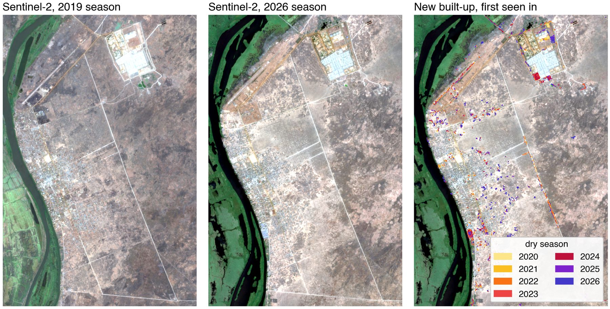
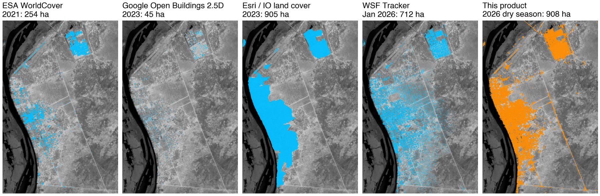
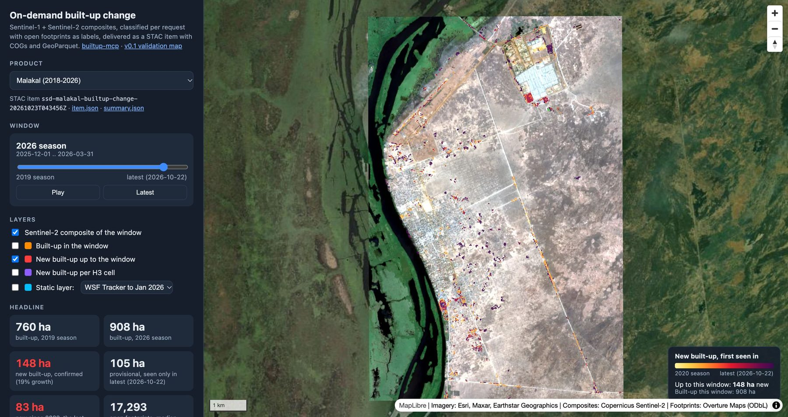
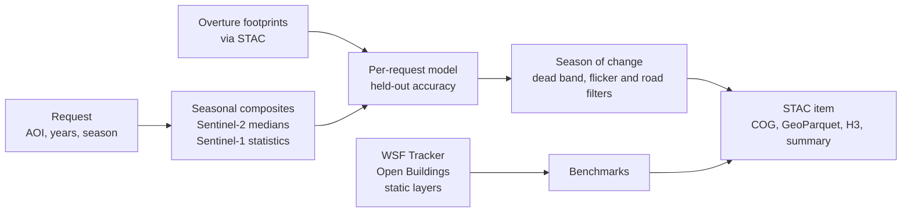

# builtup-mcp

**Built-up change, on demand.** Ask for any city or area, any years, and get back where new built-up appeared, the dry season it first showed up in, how accurate the result is for that place, and how it compares with the published global layers. Everything runs on open data, and results are delivered as a standard STAC item.

[](https://cgiovando.github.io/builtup-mcp/)

*Malakal, South Sudan: Sentinel-2 dry-season composites for 2019 and 2026, and new built-up coloured by the season it first appeared. [Open the interactive explorer.](https://cgiovando.github.io/builtup-mcp/)*

## Why

Annual and static global layers describe cities as they were one to eight years ago, several of their recent epochs are modelled rather than observed, and they rarely state accuracy for the place being asked about. For one 66 sq km area over Malakal, the newest epochs of five layers range from 45 ha to 908 ha of built-up:



`builtup-mcp` produces the change product for the request instead: from Sentinel-1 radar and Sentinel-2 imagery, with a model trained on the area's own open building footprints, benchmarked against the [WSF Tracker](https://source.coop/mindearth/wsf) and Google Open Buildings Temporal in every run.

## Try it

- **Explorer:** [cgiovando.github.io/builtup-mcp](https://cgiovando.github.io/builtup-mcp/) shows Malakal (a 66 sq km box and the 106 sq km area of the city request), Renk, Juba and Kigali with a season slider, static-layer overlays and neighbourhood statistics.
- **v0.1 validation map:** [cgiovando.github.io/builtup-mcp/v0.1](https://cgiovando.github.io/builtup-mcp/v0.1/) has the original four-city comparison with Google Open Buildings.

[](https://cgiovando.github.io/builtup-mcp/)

## Quickstart

Requires Python 3.12 and [`uv`](https://docs.astral.sh/uv/). No accounts or keys: all inputs are read anonymously.

```bash
git clone https://github.com/cgiovando/builtup-mcp && cd builtup-mcp
uv sync --extra vector --extra raster

uv run builtup-request requests/malakal.json --plan   # seasons and scene counts, in seconds
uv run builtup-request requests/malakal.json          # build the product (about 10 min first time, 1 min cached)
uv run builtup-demo                                   # explore it at http://localhost:8765
```

## A request

A request is a small JSON file. This one compares the December-March dry season every year from 2019 to 2026, plus a rolling window of the last 90 days:

```json
{
  "request_id": "ssd-malakal-builtup-change",
  "city": "Malakal",
  "country": "South Sudan",
  "aoi": {"bbox": [31.640, 9.490, 31.700, 9.580]},
  "period": {"start_year": 2019, "end_year": 2026, "season_months": [12, 1, 2, 3]},
  "latest_window_days": 90
}
```

The AOI can also be a GeoJSON geometry (`"geometry"`) or a file (`"path"`), and `options.footprints` can point to your own footprint file to use as labels and to receive the age attribute.

The run prints a summary like this one (Malakal, 22 Oct 2026):

```text
Malakal: 65.56 sq km, 9 windows 2018-12-01 .. 2026-10-22.
Built-up in first window (2019 season): 760.2 ha; 2026 season: 908.3 ha;
new built-up detected: 148.1 ha (plus 104.6 ha provisional, seen only in the latest window).
Held-out agreement with footprint labels (fused model): F1 0.914.
Sentinel-1 unavailable (optical-only) for: 2022 season, 2023 season, 2024 season, 2025 season.
WSF Tracker (DLR/MindEarth), built by Jan 2026: 712.2 ha built.
Footprint baseline: 17293 footprints, median source update 2022-05-10.
```

## Ask an agent

The same capabilities are exposed as [Model Context Protocol](https://modelcontextprotocol.io) tools, so any MCP client (Claude, Copilot Studio, a custom agent) can answer questions from the products. The repository's `.mcp.json` registers the server for Claude Code; for other clients, point them at `uv run builtup-mcp`.

> **"Which cities grew fastest?"** calls `compare_products`
> ```text
> - Renk: built-up 846.7 -> 1114.9 ha (2019-2026), 4.0%/yr, new 268.2 ha
> - Malakal: built-up 760.2 -> 908.3 ha (2019-2026), 2.6%/yr, new 148.1 ha
> - Juba: built-up 4103.4 -> 4723.5 ha (2019-2026), 2.0%/yr, new 620.1 ha
> - Kigali: built-up 4288.7 -> 4549.1 ha (2019-2026), 0.8%/yr, new 260.4 ha
> ```

> **"What data is there for Renk?"** calls `plan_city_request` (run before the Renk product existed)
> ```text
> Renk: 77.1 sq km bbox, 6 windows.
> - 2022 season (2021-12-01..2022-03-31): Sentinel-2 60 scenes, Sentinel-1 2 scenes
> - 2023 season (2022-12-01..2023-03-31): Sentinel-2 62 scenes, Sentinel-1 0 scenes
> - 2024 season (2023-12-01..2024-03-31): Sentinel-2 51 scenes, Sentinel-1 0 scenes
> ...
> ```

| Tool | What it does |
| --- | --- |
| `plan_city_request` | Expand a request into seasonal windows and count Sentinel-1/-2 scenes per window |
| `run_city_request` | Produce the change product and add it to the local STAC catalog |
| `list_products`, `get_product_summary` | Browse products: areas, accuracy, data gaps, static-layer comparison |
| `rank_neighbourhoods` | Rank H3 cells of a product by new built-up or growth |
| `compare_products` | Rank city products by growth per year |
| `static_layers_report` | Newest epoch and built-up area of open static layers over a bbox |
| `detect_builtup_change` | The v0.1 two-date heuristic over a small bbox |

## How it works



1. **Composites.** For each season, the clearest Sentinel-2 scenes are cloud-masked and reduced to a per-band median, with the 2022 processing-baseline offset removed. Sentinel-1 acquisitions from one orbit direction give the median and temporal spread of backscatter, which separates stable built structures from bare soil.
2. **Per-request model.** Open footprints become labels: built-up where buildings cover at least a quarter of a 10 m pixel, not built-up more than 40 m from any footprint. A gradient-boosted classifier is trained on samples pooled across all seasons, with fused, optical-only and radar-only variants, so cloud gaps and Sentinel-1 gaps degrade the product instead of stopping it. Accuracy is measured on spatially held-out 500 m blocks.
3. **Season of change.** New built-up is dated to the first built season after the last not-built season. Isolated pixels and thin road-like features are removed. The off-season rolling window only adds provisional detections.
4. **Delivery.** A STAC item in a self-contained catalog, readable from QGIS, Python, R, Databricks or any STAC client.

Full detail, including the benchmarks and limitations, is in **[METHODOLOGY.md](METHODOLOGY.md)**.

## What a product contains

```text
products/
  catalog.json
  builtup-change/
    collection.json
    ssd-malakal-builtup-change-<run>/
      ssd-malakal-builtup-change-<run>.json   STAC item
      builtup_probability.tif                 COG, one band per season (0-100)
      gain_epoch.tif                          COG, season in which built-up first appeared
      gain_polygons.parquet / .geojson        new built-up: season, area, confidence, provisional flag
      h3_stats.parquet / .geojson             per-hexagon built-up and growth (H3 res 8)
      footprints_age.parquet                  footprints with the season they first read as built-up
      quicklook_*.png, built_*.png            per-season imagery and masks
      summary.json                            provenance, accuracy, benchmarks, static-layer ages
```

## Results so far

| | Malakal | Renk | Juba | Kigali |
| --- | --- | --- | --- | --- |
| Area, season | 66 sq km, Dec-Mar | 77 sq km, Dec-Mar | 66 sq km, Dec-Mar | 69 sq km, Jun-Aug |
| Built-up, 2019 to 2026 (ha) | 760 to 908 | 847 to 1,115 | 4,103 to 4,724 | 4,289 to 4,549 |
| New built-up, confirmed (ha) | 148 | 268 | 620 | 260 |
| Agreement with WSF Tracker on built-up extent (F1) | 0.76 | 0.88 | 0.97 | 0.96 |
| Agreement with WSF Tracker on which pixels are new (F1) | 0.21 | 0.36 | 0.42 | 0.49 |

In Renk, the border town where more than 800,000 people crossed from Sudan from April 2023 ([REACH, July 2025](https://repository.impact-initiatives.org/document/repository/8d39fa52/REACH_SSD_Brief_Renk-Emergency-Assessment_July-2025.pdf)), two-thirds of the new built-up first appears in the 2024-2026 dry seasons.

The two products agree on where the towns are and on the trend of growth, but much less on which pixels are new. In Malakal, image checks found errors on both sides. That is why a reference sample from very-high-resolution imagery is the next step, not a claim that either product is right.

## Limitations

- 10 m built-up surface, not individual buildings; small shelters are detected as clusters.
- Bright bare ground can read as built-up, so some early construction is missed.
- Labels come from footprint maps, so held-out scores measure consistency with mapped buildings, not ground truth.
- No independent reference after January 2026; Sentinel-1 backscatter only, no coherence.
- Depends on Microsoft Planetary Computer for Sentinel data; the STAC reader can be pointed at another catalog.

## Development

```bash
uv run pytest -q -m "not network"         # offline tests
uv run pytest -q -m network               # live checks against the data providers
uv run python scripts/export_pages.py     # refresh the GitHub Pages explorer from local products
```

## AI-assisted development

> This project was developed with significant assistance from AI coding tools.

- **[Claude Code](https://claude.ai/claude-code)** (Anthropic): code generation, architecture, debugging, and documentation
- All functionality has been tested and verified to work as intended
- Features and infrastructure choices have been reviewed and approved by the maintainer

This disclosure follows emerging best practices for transparency in AI-assisted software development.

## License

Licensed under the Apache License, Version 2.0. See [LICENSE](LICENSE).

Data and references keep their own licenses: Copernicus Sentinel-1/2 (open), Overture Maps (ODbL), WSF Tracker (DLR / MindEarth, see DOI 10.5281/zenodo.20424537), Google Open Buildings 2.5D Temporal (CC-BY-4.0 / ODbL), ESA WorldCover and Esri / Impact Observatory land cover (CC-BY-4.0).
