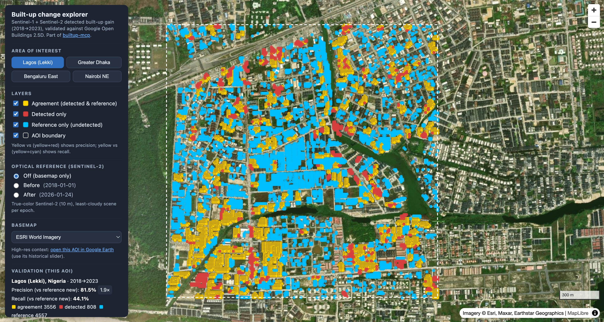

# builtup-mcp

[](https://cgiovando.github.io/builtup-mcp/)

*Detected built-up gain (yellow = confirmed by Google Open Buildings, red = detected only, cyan = reference only) over an evidence-selected hotspot in Lagos, 2018-2023. [Explore all four cities interactively.](https://cgiovando.github.io/builtup-mcp/)*

An on-demand [Model Context Protocol](https://modelcontextprotocol.io) (MCP) server that produces **built-up change products** for a city or any area of interest: where built-up area appeared, dated to the season it was first observed, at 10 m, up to the most recent satellite pass. It is built for questions that annual or static global layers cannot answer, such as fast-growing towns and displacement settlements.

A request names an AOI, a year range and the calendar months to compare. The server builds Sentinel-2 and Sentinel-1 seasonal composites, trains a classifier on the AOI's own Overture building footprints, dates each new built-up pixel, benchmarks the result against WSF Tracker and Google Open Buildings 2.5D Temporal, and writes a STAC item with COG, GeoParquet and JSON assets. All inputs are open and read anonymously from cloud-native endpoints.

## Status

Research prototype, version 0.2. See **[METHODOLOGY.md](METHODOLOGY.md)** for the method, benchmarks and limitations.

## MCP tools

| Tool | What it does |
| --- | --- |
| `plan_city_request` | Expand a request into composite windows and count Sentinel-1/-2 scenes per window (seconds) |
| `run_city_request` | Produce the change product and add it to the local STAC catalog |
| `list_products`, `get_product_summary` | Browse products: areas, accuracy, data gaps, static-layer comparison |
| `rank_neighbourhoods` | Rank H3 cells of a product by new built-up or growth |
| `compare_products` | Rank city products by growth per year |
| `static_layers_report` | Newest epoch and built-up area of open static layers over a bbox |
| `detect_builtup_change` | The v0.1 two-date heuristic over a small bbox |

A product contains `builtup_probability.tif` (COG, one band per window), `gain_epoch.tif` (COG), `gain_polygons` and `h3_stats` (GeoParquet and GeoJSON), `footprints_age.parquet`, quicklooks, and `summary.json` with provenance (scene ids per window, Overture release, model, held-out accuracy, benchmarks).

## Interactive map

The original four-city explorer of the v0.1 validation lives in [`docs/`](docs/) and on GitHub Pages: **https://cgiovando.github.io/builtup-mcp/**

The v0.2 product explorer in [`app/`](app/) reads the local STAC catalog:

```bash
uv run builtup-demo            # http://localhost:8765
```

## Requirements

- Python 3.12
- [`uv`](https://docs.astral.sh/uv/)

## Setup

```bash
uv sync --extra vector --extra raster
```

## Usage

Run a request from the command line:

```bash
uv run builtup-request requests/malakal.json --plan   # windows and scene counts
uv run builtup-request requests/malakal.json          # build the product
```

Run the server over stdio and register it with any MCP client (`.mcp.json` in this repository does that for Claude Code):

```bash
uv run builtup-mcp
```

Products go to `~/.cache/builtup-mcp/products` (`BUILTUP_MCP_PRODUCTS_DIR`) and composites are cached in `~/.cache/builtup-mcp/composites` (`BUILTUP_MCP_CACHE_DIR`), so re-runs take about a minute. City requests are capped at 150 sq km (`BUILTUP_MCP_CITY_MAX_KM2`).

## Development

```bash
uv run pytest -q
```

## AI-assisted development

> This project was developed with significant assistance from AI coding tools.

- **[Claude Code](https://claude.ai/claude-code)** (Anthropic) - code generation, architecture, debugging, and documentation
- All functionality has been tested and verified to work as intended
- Features and infrastructure choices have been reviewed and approved by the maintainer

This disclosure follows emerging best practices for transparency in AI-assisted software development.

## License

Licensed under the Apache License, Version 2.0. See [LICENSE](LICENSE).

Data and references retain their own licenses: Overture Maps (ODbL), Copernicus Sentinel-1/2 (open), Google Open Buildings 2.5D Temporal (CC-BY-4.0 / ODbL), WSF Tracker (DLR / MindEarth, see DOI 10.5281/zenodo.20424537), ESA WorldCover and Esri / Impact Observatory land cover (CC-BY-4.0).
